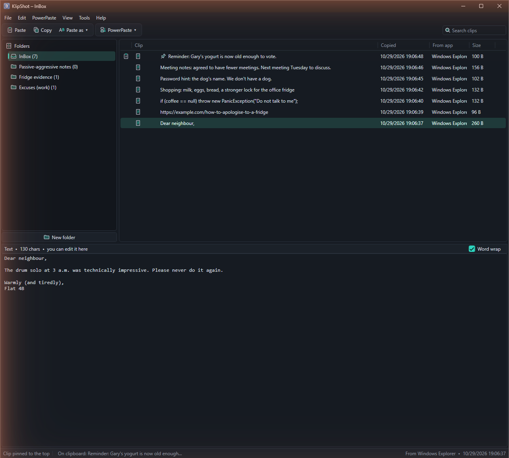
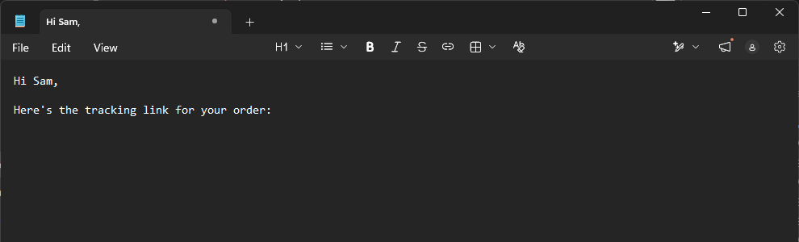
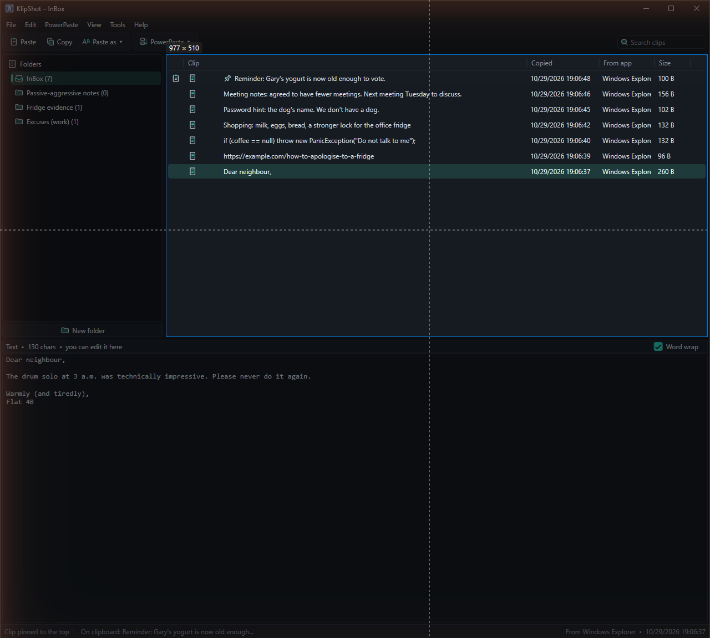
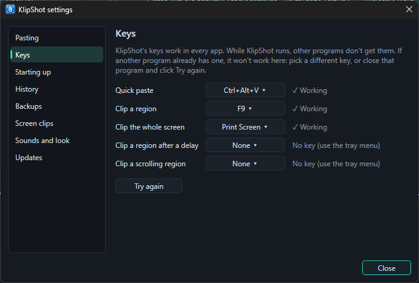

# KlipShot guide

Everything KlipShot does, by task. For a short overview and the download, see the [README](README.md).

This guide describes the latest KlipShot. If something here is missing in yours, update with **Help → Check for updates**, or see the [CHANGELOG](CHANGELOG.md) for when it arrived.

- [Getting started](#getting-started)
- [The clip list](#the-clip-list)
- [Pasting](#pasting)
- [Quick paste](#quick-paste)
- [PowerPaste](#powerpaste)
- [Organising clips](#organising-clips)
- [Screen clips](#screen-clips)
- [The markup editor](#the-markup-editor)
- [Text in images](#text-in-images)
- [Recipes](#recipes)
- [Smart actions](#smart-actions)
- [Keys](#keys)
- [Settings](#settings)
- [Backups](#backups)
- [Themes and window](#themes-and-window)
- [Updates](#updates)
- [Installing, moving and removing](#installing-moving-and-removing)
- [Where your clips are stored](#where-your-clips-are-stored)
- [Troubleshooting](#troubleshooting)

## Getting started

1. Copy something as usual (Ctrl+C in any app). KlipShot saves it.
2. Click the paperclip icon by the clock (under **^**) to open KlipShot.
3. Select a clip and press **Enter** (or click **Paste** on the toolbar). KlipShot hides and pastes it into the app you were using.

The first time you open the window, a short welcome note explains this. Click **Got it** to hide it.

Clicking the tray icon opens or hides the window. Right-click it for **Open KlipShot**, **Stop PowerPaste**, the four screen clips (**Clip a region**, **Clip the whole screen**, **Clip a region in 5 seconds** (or however many seconds you've chosen), **Clip a scrolling region**), **Start KlipShot when I sign in** and **Quit KlipShot**. Closing the window (Esc or ✕) leaves KlipShot running in the tray, still saving what you copy; only **Quit KlipShot** stops it.

## The clip list

KlipShot keeps text (with its formatting), images and copied files. The **InBox** is where new copies land, unless you have one of your [folders](#folders) open; it's the only place KlipShot removes old clips when it gets full (see [History size](#history-size)). New copies go to the top of the list. The list shows each clip's text or a thumbnail, when it was copied, the app it came from and its size. The preview pane at the bottom shows the selected clip in full.

- **Copying the same thing again** right after doesn't save it twice; you hear two beeps instead of one. Copying something that's already further down the list moves that clip back to the top, with the new time and app.
- **On the clipboard:** the clip that's on the clipboard right now has a clipboard icon next to its title, and the status bar and the tray icon's tooltip name it.
- **Search:** type in the **Search clips** box at the right of the toolbar (or press Ctrl+F) to show only the clips in the open folder that contain that text. It looks in the clip's text, its name and title, file names, the app it came from and the words in its image. Press Down to move into the results, Enter to paste, and Esc (or ✕) to clear the search.
- **Several clips:** Ctrl+click clips to select several, Shift+click to select a range, or Ctrl+A to select them all. Then press Del or right-click to delete, pin or move them all at once, or drag them onto a folder. KlipShot asks before deleting more than one clip. Paste and Copy use the clip you clicked last.
- **Right-click** a clip for Paste, Copy, Paste as text, Edit image, Copy text from image, Rename, Pin to top, Move to (the top or bottom of the list, or a folder) and Delete.

### Editing clips

Select a text clip and type in the preview pane. Once you change something, **Save changes** (Ctrl+S) and **Undo changes** appear: Undo changes goes back to the clip as it was. **Save changes makes a new clip** just above the original and selects it; the original stays as it was. If you keep editing the new clip and save again, it's updated rather than copied again. Clicking another clip, pasting or closing the window also saves your change this way. The new clip is plain text, so saving a formatted clip doesn't touch its formatting, but the new one has none. Ctrl+Z undoes your typing, back to the clip as it was shown. Untick **Word wrap** to see long lines as they are.

### History size

**Clips to keep in the InBox** (Tools → Settings → History) sets how many clips the InBox keeps: 25 to 1000, 100 at first. When it's full, the clips at the bottom of the list are removed first. Pinned clips and clips in folders are never removed.

## Pasting

Select a clip and press **Enter**, double-click it, or click **Paste** on the toolbar. KlipShot hides and pastes it into the app you were using. **Copy** (Ctrl+C) only puts it on the clipboard, for you to paste with Ctrl+V wherever you like.

**Paste as text** (on the toolbar, in the Edit menu, or by right-clicking a clip) pastes text with a change applied: Plain text, UPPERCASE, lowercase, Title Case, Remove extra spaces, Single line (join lines), Remove blank lines, or Clean up links (remove tracking). The saved clip stays as it was.

**Pasting several clips one by one:** in Tools → Settings → Pasting, tick **Keep the window open after pasting** and KlipShot comes back in front after each paste, so you can double-click one clip after another. Or tick **Double-click only copies** to have a double-click only put the clip on the clipboard (Enter still pastes); then press Ctrl+V in your app yourself. To paste a run of clips without going back to KlipShot at all, use [PowerPaste](#powerpaste).

## Quick paste

Press **Ctrl+Alt+V** while you're typing in any app. A small list of your InBox clips opens at the text cursor, or at the mouse in apps that draw their own cursor, such as many browsers.

- Type to search the list.
- Use Up and Down, Page Up and Page Down, or the mouse wheel to pick a clip.
- Press **Enter** or click it to paste it where you were typing.
- **Right-click** a clip to paste it as plain text, without its formatting, or with another Paste as text change, such as UPPERCASE or Single line.
- Esc, Ctrl+Alt+V again or clicking somewhere else closes the list.

Pinned clips show a pin. Ctrl+Alt+V is Paste Special in Word and Excel, so those apps don't get it while KlipShot runs. To use a different key (Alt+Shift+V, Ctrl+Shift+V, Ctrl+Alt+Space, or none), see [Keys](#keys).

## PowerPaste

For pasting several clips in a row, for example into a form:

1. Select the first clip.
2. Click **PowerPaste** on the toolbar (or open the PowerPaste menu) and choose **Start here, then older clips** (down the list) or **Start here, then newer clips** (up the list).
3. Go to the other app. Each Ctrl+V pastes the next clip.

It stops by itself at the end of the list. To stop sooner, click **Stop PowerPaste**, which shows on the toolbar while PowerPaste is on (it is also in the tray menu). Starting PowerPaste during a search pastes only the matching clips. The first time you start PowerPaste, KlipShot explains how it works.

## Organising clips

### Renaming

Right-click a clip and choose **Rename...** (or press F2, or use Edit → Rename) to give it a name that's easier to spot in the list. Only the list changes: the clip's text, image or files stay exactly as copied, and pasting it pastes the original. Search matches the new name as well as the clip's content. To go back to the clip's own text, rename it and leave the name empty.

### Pin to top

Right-click a clip and choose **Pin to top** (or press Ctrl+P, or use Edit → Pin to top). Pinned clips show a pin and stay at the top of their folder or the InBox; new copies go just below them. Pinned clips are never removed by the history size limit. To unpin, right-click it and choose **Unpin**.

To move a clip without pinning it, right-click it and choose **Move to → Top** (Alt+Home) or **Move to → Bottom** (Alt+End), also in the Edit menu. Top puts it just below any pinned clips; a pinned clip moves to the top or bottom of the pinned ones. With several clips selected, they all move and keep their order. In a full InBox, clips at the bottom are the first to be removed (see [History size](#history-size)).

### Folders

- Click **New folder** under the folder list (or File → New folder, or right-click **Folders**) to create one. Right-click a folder to rename, lock or delete it. Deleting a folder moves its clips to the InBox, and the folders inside it move up a level.
- **Folders inside folders:** right-click a folder and choose **New folder inside**, or drag a folder onto another one. Click the arrow beside a folder to show or hide the folders inside it; KlipShot remembers which are open. The InBox can't hold folders.
- New copies go into the folder you have open. The window title shows which one that is, for example **KlipShot – InBox** or **KlipShot – Work**.
- To move a clip, drag it onto a folder, or right-click it and choose **Move to** and the folder (also in the Edit menu).
- A **locked** folder (🔒) never receives new copies. Those go to the InBox, which turns bold so you can see where they went. A note above the clip list reminds you when the open folder is locked.
- **Go back to the InBox after pasting** (Tools → Settings → Pasting) switches back to the InBox after you paste from a folder, so your next copy lands there.

### Drag and drop

While you drag, the clip or folder you're moving fades and its name follows the mouse. A line shows where it will go, or a box around the folder it will go into.

- Drag a clip up or down the list to reorder. Drop it on the top half of a row to put it above that clip, or the bottom half to put it below. (Clear the search first.) Hold it near the top or bottom of the list to scroll.
- Drag a clip onto a folder or the InBox to move it there. This works on locked folders too.
- Drag a folder near the top or bottom edge of another folder to put it above or below that one, or onto the middle of it to put it inside. Drop it on **Folders** to move it to the bottom of the top level.

## Screen clips

Press **F9** anywhere to clip a region. The screen freezes and dims, so open menus and tooltips stay as they were.

- **Drag** over the part you want. Its sides snap to nearby edges, such as a pane's border; hold Alt to drag freely.
- **Click** to take the outlined window or pane under the mouse. This works in most apps, including ones that only draw their panes, such as games and video. Point at the title bar or edge of a window to take all of it.
- Esc or a right-click cancels.

Press **Print Screen** to clip the whole screen (every monitor). Both are also in the tray icon's menu. Each clip opens in the [markup editor](#the-markup-editor).

**Delayed clip:** for a menu, tooltip or hover effect that only shows while you use the mouse, right-click the tray icon and choose **Clip a region in 5 seconds** (the number follows your setting). Then open what you want in the clip. A countdown shows at the bottom right of the screen, without taking the focus, so menus stay open. When it ends, the screen freezes as with F9. Choose 3, 5 or 10 seconds in Tools → Settings → Screen clips, and give it a key under [Keys](#keys). Pressing the key again during the countdown stops it.

**Scrolling clip:** to clip more than fits on the screen, such as a long web page, document or chat, right-click the tray icon and choose **Clip a scrolling region** (or give it a key under [Keys](#keys)). Then drag over the part that scrolls, or click it to take that pane. KlipShot scrolls it down a screenful at a time and joins what comes into view into one tall clip, which opens in the editor.

- A header or toolbar that stays in place is kept once, even one that changes colour as the page moves (as YouTube's does).
- Menus and columns that stay put at the sides (YouTube's menu, Facebook's shortcuts and contacts, Craigslist's filters) and the page's scrollbar are left off, so the clip is just the part that scrolled.
- It waits for posts and videos that load as you scroll, so the clip gets them rather than grey placeholders, and it copes with pages that scroll over a background that stays put (Plex).
- While it works, the mouse sits over the scrollbar so videos don't start playing under it; leave the mouse alone until the editor opens.
- It stops at the end of the page; press Esc, or the key again, to stop sooner. Very long pages stop at 30,000 pixels. A big one-colour gap taller than the region looks like the end of the page, and pages that change a lot as they scroll (animations, videos playing) can stop it early; the editor's title says why it stopped.

If Print Screen doesn't work, turn off **Use the Print Screen key to open screen capture** in Windows Settings → Accessibility → Keyboard.

## The markup editor

A screen clip opens in an editor, over the spot it came from (a tall scrolling clip opens at a readable size and scrolls).

| Tool | Key | What it does |
| --- | --- | --- |
| Select | V | Click a mark to move it; Del removes it |
| Arrow | A | Drag from the tail to the point |
| Rectangle | R | An outlined box |
| Pen | P | Draw freehand |
| Highlighter | H | A see-through box over text |
| Text | T | Click, type, then Enter (Shift+Enter for a new line, Esc to cancel) |
| Blur | B | Pixelates passwords, emails and other private details. The real pixels are replaced, so they can't be recovered |
| Crop | C | Drag over the part to keep |

Pick a colour and a line width on the toolbar (the width also sets the text size). KlipShot remembers the tool, colour and width you used last. Ctrl+Z undoes and Ctrl+Y redoes, including moves and crops.

- **Copy** (Enter or Ctrl+C) puts the marked-up clip on the clipboard and closes the editor. KlipShot saves it as an image clip like any other copy.
- **Save** (Ctrl+S) saves it as a PNG file. The editor stays open.
- **Esc** or ✕ closes without copying. If you've drawn anything you haven't saved, KlipShot asks first.

You can take more clips while an editor is open; each one gets its own editor.

**Edit image:** to mark up an image clip you already have (a screen clip, or any image you copied), select it and press **Ctrl+E**, or right-click it → **Edit image**. Copy saves the result as a new clip just above the original, selects it and puts it on the clipboard. The original stays as it was.

## Text in images

To get the words out of an image clip (a screenshot of an error, a scanned page, a slide), select it and press **Ctrl+T**, or right-click it → **Copy text from image**. KlipShot reads the text, puts it on the clipboard and saves it as a text clip; the image clip stays as it was.

KlipShot also reads the text in every image clip by itself, a moment after it's copied, so search finds image clips by the words in them.

The reading is done by Windows, on your PC, in the languages set up in Windows. If Windows can't read any of them, KlipShot says how to add one (Windows Settings → Time & language → Language & region → your language's options → Optical character recognition). Handwriting and stylised lettering are often not read.

## Recipes

A recipe is a text clip with blanks in double braces. Type one into any app and copy it, or edit a clip in the preview:

`Hi {{name}}, your order {{clipboard}} ships {{date+3}}.`

When you paste it, a small window asks for each blank once, however often it appears. Press Enter to paste, or **Paste as it is** to leave the blanks in. These fill themselves in:

| Blank | Becomes |
|---|---|
| `{{clipboard}}` | The text on the clipboard |
| `{{date}}` | Today's date |
| `{{date+3}}`, `{{date-1}}` | That many days from today or before it |
| `{{time}}` | The time now |

To choose how dates and times are written, such as `2026-10-30` or `8:06 PM`, go to Tools → Settings → Pasting. At first they follow your Windows settings. If you copy templates or code that use double braces, turn off **Fill in recipes when pasting** there, or press **Paste as it is** when asked.

Recipes work with Enter, a double-click and quick paste, but not PowerPaste, and they paste as plain text. Copy to clipboard (Ctrl+C) copies the clip with its blanks. File recipes in a folder or pin them to keep them.

## Smart actions

When a clip has web links, email addresses, US street addresses or phone numbers in it, or an image clip has a QR code, a **Show links** button appears above the preview, with how many it found. Nothing pops up, and the clip still pastes exactly as copied.

Click **Show links** and they become clickable: web links open in your browser, email addresses in your mail app, street addresses in Google Maps, and phone numbers open in your calling app, such as Phone Link, if you have one. **Hide links**, or picking another clip, goes back to the usual view. Right-click one to open it or **Copy to a new clip**, which saves just that link or address as its own clip and puts it on the clipboard. You can't edit a clip's text while its links are showing.

This works on image clips too, using the words KlipShot reads in the picture: each link is marked on the image, right where it is. Text read from a picture can have mistakes, so point at a mark to see what will open before you click it. Links shown only as words, such as "Click here", can't be found, because the address isn't in the picture.

A QR code is marked on the picture too. Point at it to see what it holds before you open it, as a code can lead anywhere. If it holds a link, phone number or email address, clicking opens it. If it holds anything else, clicking copies it to a new clip. For Wi-Fi details, KlipShot shows only the network's name, but the copy includes the password.

Phone numbers need an area code and separators, such as `(904) 555-1234`, `904-555-1234` or `+1 904 555 1234`, or a + and a country code. Ten digits in a row aren't picked up, as those are as often order numbers.

In [quick paste](#quick-paste), right-click a clip to see its links and addresses, up to ten, each with Open and Copy to a new clip.

Addresses are US style and can be in the middle of other text. Capitals don't matter and a ZIP isn't needed. An address needs a house number, and either a street type such as St, Ave or Road, or a city and state after the street:

- `123 main st`
- `545 cathy trip ln, jacksonville, florida`
- `1 apple park, cupertino, ca`

PO boxes aren't picked up. KlipShot leans towards finding more, so now and then it may underline something that isn't an address, or start from the wrong word. That's harmless: the clip isn't changed, and the underline shows exactly what was found.

To turn them off, all or by type, go to Tools → Settings → Smart actions.

## Keys

In the KlipShot window:

| Key | What it does |
| --- | --- |
| Enter or double-click | Paste the clip into the app you were using |
| Ctrl+C | Put the clip on the clipboard without pasting |
| F2 | Rename the clip in the list (its content stays as it is) |
| Ctrl+P | Pin the clip to the top, or unpin it |
| Ctrl+E | Mark up an image clip |
| Ctrl+T | Copy the words in an image clip as text |
| Del | Delete the clip (or all the selected clips) |
| Ctrl+click, Shift+click | Select several clips, or a range of clips |
| Ctrl+A | Select every clip in the list |
| Ctrl+F | Search the clips in the open folder |
| Ctrl+S | Save an edited text clip (as a new clip) |
| Esc | Clear the search, or close the window (KlipShot keeps running in the tray) |

In any app, while KlipShot runs:

| Key | What it does |
| --- | --- |
| Ctrl+Alt+V | [Quick paste](#quick-paste) |
| F9 | Clip a region of the screen |
| Print Screen | Clip the whole screen |
| Ctrl+V while PowerPaste is on | Paste the next clip |

**Help → Keyboard shortcuts** lists them too.

### Changing keys

- **Where:** Tools → Settings → **Keys** lists every KlipShot key: quick paste, clip a region, clip the whole screen, the delayed clip and the scrolling clip. The last two have no key at first.
- **Choices:** screen clips can use F7, F8, F9, Ctrl+Shift+F9, Print Screen, Ctrl+Print Screen or none. Quick paste can use Ctrl+Alt+V, Alt+Shift+V, Ctrl+Shift+V, Ctrl+Alt+Space or none. A key another KlipShot feature already uses isn't offered.
- **Status:** each key shows **✓ Working**, **No key**, or **⚠ Another program has this key**. While KlipShot runs, other programs don't get its keys, but a program that took a key first keeps it. KlipShot also tells you at startup which keys are taken.
- **Try again:** close the program that has the key, then click **Try again**. Or pick a different key.

## Settings

**Tools → Settings** has every option in one place, each with a line saying what it does. Pick a section on the left to see its options. Changes apply at once, and while KlipShot runs, Settings opens on the section you last looked at.

| Section | What's there |
| --- | --- |
| Pasting | Keep the window open after pasting, Double-click only copies, Go back to the InBox after pasting, [recipes](#recipes) on or off and how they write dates and times; quick paste is explained here |
| Smart actions | [Turn Show links off](#smart-actions), all or by type |
| Keys | Every KlipShot key, whether it works, and [Try again](#keys) |
| Starting up | Start KlipShot when I sign in to Windows, Show the window when KlipShot starts, Import from a portable copy |
| History | [Clips to keep in the InBox](#history-size) |
| Backups | [Automatic backups, Back up now and Restore](#backups) |
| Screen clips | How long a delayed clip waits |
| Sounds and look | [Sounds](#sounds), always on top, button labels |
| Updates | [Check for updates when KlipShot starts](#updates) |

### Sounds

KlipShot beeps once when it saves a copy, and twice when you copy the same thing again right after (that repeat isn't saved). Turn them off with **Play a sound when a copy is saved**. If beeps are sometimes missing, as can happen on a remote desktop or VDI, turn on **Keep the sound ready so no beep is missed**. KlipShot then plays silence all the time, so Windows sees sound playing: the PC may not go to sleep by itself, and Bluetooth headphones stay connected and use battery.

## Backups

**Back up my clips automatically** (Tools → Settings → Backups) saves a copy of all your clips, folders and settings every hour, every 6 hours, every day or every week while KlipShot runs. It is off unless you turn it on. **Back up now** makes a copy straight away, whether automatic backups are on or not, and **Open backups folder** shows where they are. **Change folder...** sends backups to a folder you pick instead, such as another drive or a synced folder; **Use default folder** goes back.

Backups go in a `Backups` folder next to `KlipShot.db` unless you pick another, named by date and time (for example `KlipShot-2026-10-27-120939.db`). The newest 10 are kept and older ones are deleted. KlipShot keeps working while it backs up. If an automatic backup fails (for example because the folder you picked is on a drive that isn't plugged in), a notice appears by the clock. Changing the folder doesn't move backups already made.

To restore a backup, click **Restore a backup...** and pick one. KlipShot asks first, then restarts with the clips, folders and settings from that backup. Your backup settings (how often, and which folder) stay as they are. What was there before is kept as `KlipShot.before-restore.db` next to `KlipShot.db`: to undo the restore, pick that file the same way (choose "All KlipShot databases" in the file picker to see it). A backup made by a newer version of KlipShot can't be restored until you update.

## Themes and window

**View → Theme**: Classic, Follow Windows (light or dark to match Windows), Fluent, Latte, Solarized Light, Midnight, Nord, Dracula, Gruvbox, Everforest or Rosé Pine.

**View → Button labels** (also in Settings) shows the names next to the toolbar icons. Untick it for a smaller toolbar with just icons; point at a button to see what it does.

**View → Always on top** (also in Settings) keeps the KlipShot window above other windows while it's open.

KlipShot remembers the window's size and position, how you've dragged the borders between the panes, and the width of each column in the clip list.

## Updates

**Help → Check for updates** asks GitHub for the latest version. If there's a newer one, KlipShot asks whether to update now. Nothing is downloaded unless you say yes. Then KlipShot:

1. Downloads the new version (about 70 MB) from GitHub, showing its progress. You can cancel. An installed KlipShot downloads the setup; a portable one downloads the zip.
2. Checks it against the SHA-256 checksum GitHub publishes for the file, and refuses anything that doesn't match.
3. Installed: quits and runs the setup without any questions, which installs the new version and starts it. The new KlipShot then deletes the downloaded setup, so nothing is left behind.
   Portable: swaps `KlipShot.exe` for the new one and restarts. The old copy is kept as `KlipShot.old.exe` until the new one starts, then deleted.

Your clips and settings (`KlipShot.db`) are kept. If KlipShot's folder isn't writable (for example under `Program Files`), it offers to open the download page instead; then quit KlipShot and replace `KlipShot.exe` by hand. You can also update by hand at any time: run the new setup, or, for the portable copy, quit KlipShot and replace `KlipShot.exe`.

KlipShot isn't code-signed, so Windows SmartScreen or antivirus may now and then be wary of a freshly downloaded `KlipShot.exe` or setup. That's the same whether KlipShot updates itself or you download it by hand.

To check automatically, turn on **Check for updates when KlipShot starts** in Tools → Settings → Updates. It is off unless you turn it on. KlipShot then checks at most once a day, a few seconds after it starts. It says nothing when you are up to date or offline. When there is a newer version, a notice appears by the clock, and clicking it asks whether to update.

## Installing, moving and removing

**Starting with Windows:** tick **Start KlipShot when I sign in to Windows** in Tools → Settings → Starting up (or right-click the tray icon and tick **Start KlipShot when I sign in**). KlipShot starts hidden in the tray; tick **Show the window when KlipShot starts** to have the window open instead.

**Moving from the portable copy to the setup:** quit the portable KlipShot, then install. The first time the installed KlipShot starts, it offers to bring in your clips, folders, settings and backups; say yes and pick the portable copy's folder. You can also do it later with **Import from a portable copy...** in Tools → Settings → Starting up. The portable copy isn't changed, so delete its folder once you're happy. The clips that were in the installed copy before the import are kept as `KlipShot.before-import.db` next to `KlipShot.exe`, in case you need them.

**Coming from Clippy** (KlipShot's old name): quit Clippy (right-click its tray icon → Quit Clippy), put `KlipShot.exe` in the same folder and delete `Clippy.exe`. The first time KlipShot runs, it takes over your clips, folders and settings (renaming `Clippy.db` to `KlipShot.db`), and replaces Clippy's "start when I sign in" entry with its own.

**Removing KlipShot:** use **Settings → Apps → Installed apps → KlipShot → Uninstall** in Windows. It asks whether to delete your clips too, and keeps them unless you say yes. For the portable copy, quit KlipShot and delete its folder.

## Where your clips are stored

Clips and settings are kept in `KlipShot.db` next to `KlipShot.exe`, so everything is in one folder: `%LocalAppData%\Programs\KlipShot` if you used the setup, or wherever you unzipped the portable copy. If that folder isn't writable (for example under `Program Files`), KlipShot uses `%LocalAppData%\KlipShot` instead. Help → About shows the exact path.

When an update changes how `KlipShot.db` is laid out, KlipShot first saves a copy of it as it was, such as `KlipShot.before-v2.db`, in the same folder, and tells you. Only the latest copy is kept. To go back to it, use **Restore a backup...** in Tools → Settings → Backups. If the update can't finish, your clips are left as they were. If you go back to an older KlipShot after using a newer one, it warns that some newer things may be missing.

**Passwords and other private things you copy are saved too**, like everything else, and `KlipShot.db` and its backups aren't encrypted. Anyone who can open your Windows account's files can read them. To remove something, select the clip and press Del; it's then gone from KlipShot, though older backups still have it until they're replaced.

Everything stays on your PC. KlipShot only connects to the internet when you choose Help → Check for updates (or at startup, if you turn that on), and then only to ask GitHub for the latest version number. It downloads an update only when you say yes.

## Troubleshooting

- **A key does nothing.** Open Tools → Settings → [Keys](#changing-keys). If it says another program has the key, pick a different one, or close that program and click Try again.
- **Print Screen opens the Windows snipping tool instead.** Turn off **Use the Print Screen key to open screen capture** in Windows Settings → Accessibility → Keyboard, then click Try again on the Keys page.
- **Quick paste opens at the mouse, not where I'm typing.** Some apps, including many browsers, draw their own text cursor and don't tell Windows where it is. The list then opens at the mouse; it still pastes where you were typing.
- **A paste lands in the wrong window, or nowhere.** KlipShot pastes into the last window you used before it. Click into the place you want to paste, then open KlipShot (or use [quick paste](#quick-paste), which never leaves the app you're in). Apps running as administrator don't accept pastes sent by KlipShot unless KlipShot runs as administrator too.
- **Copy beeps are sometimes missing**, often on a remote desktop or VDI. Turn on **Keep the sound ready so no beep is missed** in Tools → Settings → Sounds and look.
- **Copy text from image finds nothing.** Windows reads the text in the languages set up in Windows; add the language's optical character recognition (see [Text in images](#text-in-images)). Handwriting and stylised lettering are often not read.
- **Windows says "Windows protected your PC".** KlipShot isn't code-signed. Click **More info**, then **Run anyway**.
