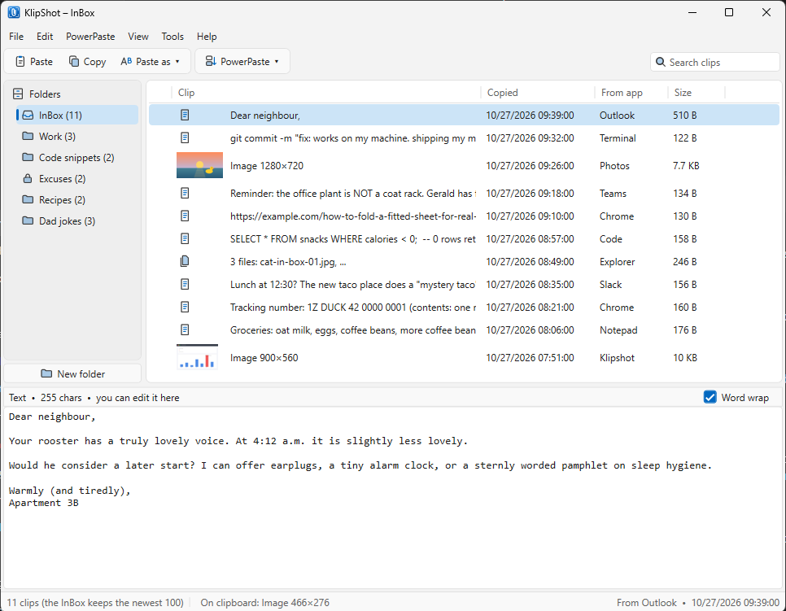
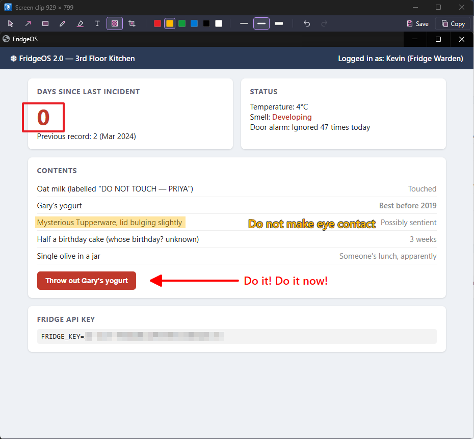
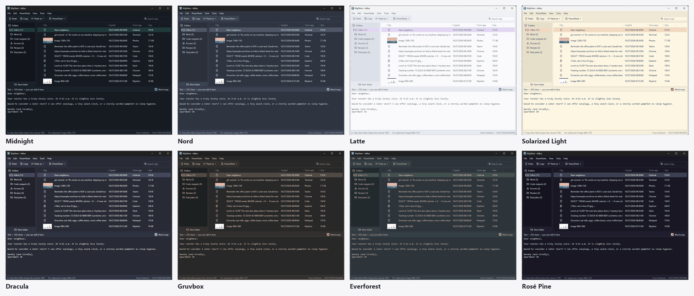

# KlipShot

Clipboard history and screen clips for Windows, in the system tray. Everything you copy is saved, and you can paste it back into whatever app you were using. Press F9 to clip part of the screen, mark it up, and it's saved with the rest of your clips.

KlipShot used to be called Clippy.

- Keeps text (with its formatting), images and copied files.
- Paste any clip back with Enter or a double-click, or paste text with a change such as UPPERCASE or Single line.
- PowerPaste: paste a run of clips one after another with Ctrl+V.
- Pin clips to the top of the list, and file clips into folders. Lock a folder to keep it as it is.
- Screen clips: F9 for a region, Print Screen for the whole screen. Mark them up with arrows, boxes, a pen, a highlighter, text and blur, and crop them.
- Optional sounds, so you hear when a copy is saved.
- One portable `KlipShot.exe`, no installer.

## Install

1. Download `KlipShot-<version>-win-x64.zip` from [Releases](https://github.com/Argusi/KlipShot-releases/releases).
2. Unzip it into any folder, for example `Documents\KlipShot`. The zip also has this README, the changelog and the licence.
3. Run `KlipShot.exe`. It starts in the tray: look under the **^** by the clock. Drag the paperclip icon onto the taskbar to keep it in view.

No .NET install is needed. To start KlipShot whenever you sign in, tick **Start KlipShot when I sign in to Windows** in **Tools → Settings** (or right-click the tray icon and tick **Start KlipShot when I sign in**). KlipShot starts hidden in the tray; tick **Show the window when KlipShot starts** in Settings to have the window open instead.

To update, choose **Help → Check for updates** and say yes; KlipShot downloads the new version, checks it and restarts. Your clips are kept. You can also update by hand: quit KlipShot (right-click the tray icon → Quit KlipShot) and replace `KlipShot.exe` with the new one.

**Coming from Clippy:** quit Clippy (right-click its tray icon → Quit Clippy), put `KlipShot.exe` in the same folder and delete `Clippy.exe`. The first time KlipShot runs, it takes over your clips, folders and settings (renaming `Clippy.db` to `KlipShot.db`), and replaces Clippy's "start when I sign in" entry with its own.

## Quick start

1. Copy something as usual (Ctrl+C in any app). KlipShot saves it.
2. Click the tray icon to open KlipShot.
3. Select a clip and press **Enter** (or click **Paste** on the toolbar). KlipShot hides and pastes it into the app you were using.

The first time you open the window, a short welcome note explains this. Click **Got it** to hide it.

## Using KlipShot

### Keys

| Key | What it does |
| --- | --- |
| Enter or double-click | Paste the clip into the app you were using (**Paste** on the toolbar) |
| Ctrl+C | Put the clip on the clipboard without pasting (**Copy** on the toolbar) |
| Ctrl+P | Pin the clip to the top, or unpin it |
| Ctrl+E | Mark up an image clip (**Edit image**) |
| Del | Delete the clip (or all the selected clips) |
| Ctrl+click, Shift+click | Select several clips, or a range of clips |
| Ctrl+A | Select every clip in the list |
| Ctrl+S | Save changes to a text clip |
| Esc | Close the window (KlipShot keeps running in the tray) |

Right-click a clip for the same actions, plus **Move to folder**. **Help → Keyboard shortcuts** lists the keys.

**Pasting several clips:** in **Tools → Settings**, tick **Keep the window open after pasting** and KlipShot comes back in front after each paste, so you can double-click one clip after another. Or tick **Double-click only copies** to have a double-click only put the clip on the clipboard (Enter still pastes); then press Ctrl+V in your app yourself.

The clip that's on the clipboard right now has a clipboard icon next to its title, and the status bar and the tray icon's tooltip name it.

Clicking the tray icon opens or hides the window. Right-click it for Open KlipShot, Stop PowerPaste, Clip a region, Clip the whole screen, Start KlipShot when I sign in and Quit KlipShot.

### Screen clips

Press **F9** anywhere to clip a region. The screen freezes and dims, so open menus and tooltips stay as they were; drag over the part you want (Esc or a right-click cancels). Press **Print Screen** to clip the whole screen (every monitor). Both are also in the tray icon's menu.

The clip opens in an editor, over the spot it came from:

| Tool | Key | What it does |
| --- | --- | --- |
| Select | V | Click a mark to move it; Del removes it |
| Arrow | A | Drag from the tail to the point |
| Rectangle | R | An outlined box |
| Pen | P | Draw freehand |
| Highlighter | H | A see-through box over text |
| Text | T | Click, type, then Enter (Shift+Enter for a new line, Esc to cancel) |
| Blur | B | Pixelates passwords, emails and other private details. The real pixels are replaced, so they can't be recovered |
| Crop | C | Drag over the part to keep |

Pick a colour and a line width on the toolbar (the width also sets the text size). KlipShot remembers the tool, colour and width you used last. Ctrl+Z undoes and Ctrl+Y redoes, including moves and crops.

- **Copy** (Enter or Ctrl+C) puts the marked-up clip on the clipboard and closes the editor. KlipShot saves it as an image clip like any other copy.
- **Save** (Ctrl+S) saves it as a PNG file. The editor stays open.
- **Esc** or ✕ closes without copying. If you've drawn anything you haven't saved, KlipShot asks first.

You can take more clips while an editor is open; each one gets its own editor.

**Edit image:** to mark up an image clip you already have (a screen clip, or any image you copied), select it and press **Ctrl+E**, or right-click it → **Edit image**. It opens in the same editor. Copy saves the result as a new clip, so the original stays as it was.

To use different keys, pick them under **Screen clips** in **Tools → Settings** (F7, F8, F9, Ctrl+Shift+F9, Print Screen, Ctrl+Print Screen, or none). While KlipShot runs, other programs don't get these keys. If another program already has one, KlipShot tells you. If Print Screen doesn't work, turn off **Use the Print Screen key to open screen capture** in Windows Settings → Accessibility → Keyboard.

### Paste as text

**Working with several clips:** Ctrl+click clips to select several, Shift+click to select a range, or Ctrl+A to select them all. Then press Del or right-click to delete, pin or move them all at once, or drag them onto a folder. KlipShot asks before deleting more than one clip. Paste and Copy use the clip you clicked last.

**Search:** type in the **Search clips** box at the right of the toolbar (or press Ctrl+F) to show only the clips in the open folder that contain that text. It looks in the clip's text, title, file names and the app it came from. Press Down to move into the results, Enter to paste, and Esc (or ✕) to clear the search. Starting PowerPaste during a search pastes only the matching clips.

**Paste as text** (on the toolbar, in the Edit menu, or by right-clicking a clip) pastes text with a change applied: Plain text, UPPERCASE, lowercase, Title Case, Remove extra spaces, Single line (join lines), Remove blank lines, or Clean up links (remove tracking). The saved clip stays as it was.

### PowerPaste

For pasting several clips in a row, for example into a form:

1. Select the first clip.
2. Click **PowerPaste** on the toolbar (or open the PowerPaste menu) and choose **Start here, then older clips** (down the list) or **Start here, then newer clips** (up the list).
3. Go to the other app. Each Ctrl+V pastes the next clip.

It stops by itself at the end of the list. To stop sooner, click **Stop PowerPaste**, which shows on the toolbar while PowerPaste is on (it is also in the tray menu). The first time you start PowerPaste, KlipShot explains how it works.

### Editing clips

Select a text clip and type in the preview pane at the bottom. Once you change something, **Save changes** (Ctrl+S) and **Undo changes** appear: Save changes keeps the change, Undo changes goes back to the saved clip. Saving a formatted clip keeps only its text, and the preview header says so. Untick **Word wrap** to see long lines as they are.

### Pin to top

Right-click a clip and choose **Pin to top** (or select it and use Edit → Pin to top, or Ctrl+P). Pinned clips show a pin and stay at the top of their folder or the InBox; new copies go just below them. Pinned clips are never removed by the history size limit. To unpin, right-click it and choose **Unpin**.

### Folders

- Click **New folder** under the folder list (or File → New folder, or right-click **Folders**) to create a folder. Right-click a folder to rename, lock or delete it. Deleting a folder moves its clips to the InBox.
- New copies go into the folder you have open. The window title shows which one that is, for example **KlipShot – InBox** or **KlipShot – Work**.
- To move a clip, drag it onto a folder, or right-click it and choose **Move to folder** (also in the Edit menu).
- A **locked** folder (🔒) never receives new copies. Those go to the InBox, which turns bold so you can see where they went. A note above the clip list reminds you when the open folder is locked.
- **Go back to the InBox after pasting** (in Tools → Settings) switches back to the InBox after you paste, so your next copy lands there.

### Drag and drop

- Drag a clip onto another clip to reorder.
- Drag a clip onto a folder or the InBox to move it there. This works on locked folders too.
- Drag a folder onto another folder to reorder, or onto **Folders** to move it to the bottom.

### Sounds

KlipShot beeps once when it saves a copy, and twice when you copy the same thing again right after (that repeat isn't saved). Turn them off with **Play a sound when a copy is saved** in **Tools → Settings**.

### History size

**Clips to keep in the InBox** in **Tools → Settings** sets how many clips the InBox keeps (25 to 1000, default 100). The oldest are removed first. Pinned clips and clips in folders are never removed.

### Themes and window

**View → Theme**: Classic, Follow Windows (light or dark to match Windows), Fluent, Latte, Solarized Light, Midnight, Nord, Dracula, Gruvbox, Everforest or Rosé Pine.

**View → Button labels** (also in Settings) shows the names next to the toolbar icons. Untick it for a smaller toolbar with just icons; point at a button to see what it does.

**View → Always on top** (also in Settings) keeps the KlipShot window above other windows while it's open.

KlipShot remembers the window's size and position, how you've dragged the borders between the panes, and the width of each column in the clip list.

### Settings

**Tools → Settings** has every option in one place, each with a line saying what it does: pasting, starting up, history size, screen clip keys, sounds, always on top, button labels and update checks. Changes apply at once.

### Updates

**Help → Check for updates** asks GitHub for the latest version. If there's a newer one, KlipShot asks whether to update now. Nothing is downloaded unless you say yes. Then KlipShot:

1. Downloads the release zip (about 70 MB) from GitHub, showing its progress. You can cancel.
2. Checks it against the SHA-256 checksum GitHub publishes for the file, and refuses anything that doesn't match.
3. Swaps `KlipShot.exe` for the new one and restarts. The old copy is kept as `KlipShot.old.exe` until the new one starts, then deleted.

Your clips and settings (`KlipShot.db`) aren't touched. If KlipShot's folder isn't writable (for example under `Program Files`), it offers to open the download page instead; then quit KlipShot and replace `KlipShot.exe` by hand.

KlipShot isn't code-signed, so Windows SmartScreen or antivirus may now and then be wary of a freshly downloaded `KlipShot.exe`. That's the same whether KlipShot updates itself or you download it by hand.

To check automatically, turn on **Check for updates when KlipShot starts** in Tools → Settings. It is off unless you turn it on. KlipShot then checks at most once a day, a few seconds after it starts. It says nothing when you are up to date or offline. When there is a newer version, a notice appears by the clock, and clicking it asks whether to update.

## Where your clips are stored

Clips and settings are kept in `KlipShot.db` next to `KlipShot.exe`, so you can move or back up the whole folder. If that folder isn't writable (for example under `Program Files`), KlipShot uses `%LocalAppData%\KlipShot` instead. Help → About shows the exact path.

Everything stays on your PC. KlipShot only connects to the internet when you choose Help → Check for updates (or at startup, if you turn that on), and then only to ask GitHub for the latest version number. It downloads an update only when you say yes.

See [CHANGELOG.md](CHANGELOG.md) for what's new.

## Licence

KlipShot is © 2026 Bruce Maloney. All rights reserved. You may use it free of charge, but not copy, share or change it; see [LICENSE](LICENSE). KlipShot comes with no warranty.
